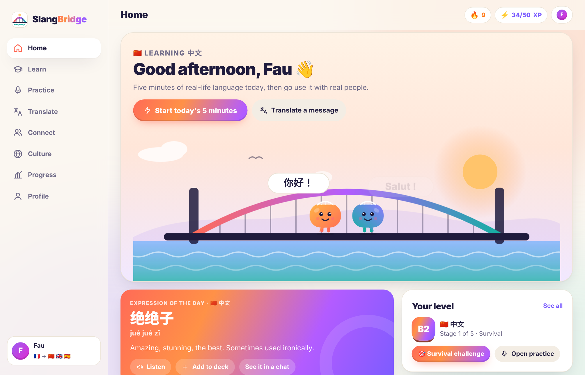
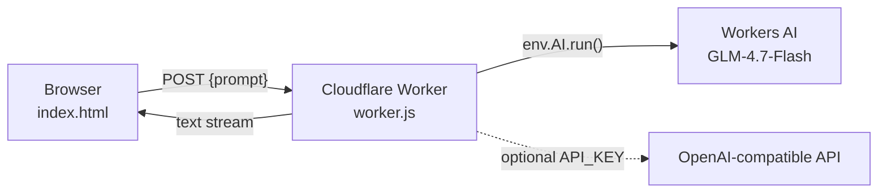

<div align="center">

# SlangBridge

**Learn the language people actually speak, and make friends who speak it.**

A social language-learning web app for students: slang, colloquialisms, idioms and everyday vocabulary, with their tone and cultural context, personalised by AI, and connected to real people across cultures.

<br>

<picture>
  <source media="(prefers-color-scheme: dark)" srcset="docs/screenshot-dark.png">
  
</picture>

</div>

## What it does

| Area | What the user gets |
|:--|:--|
| **Levels** | Every language has its own level (A1–C2), region, XP and progress bridge. A **2-minute adaptive placement test** sets the level. Each level has 5 stages: *Survival → Everyday → Casual → Slang → Culture insider*. A stage challenge (role-play + quiz) unlocks the next stage; the fifth one levels you up. |
| **Learn** | A path of short lessons per language, organised by stage. Each expression comes with its meaning, literal meaning, tone (register 1–5), who to say it to, who to avoid it with, a realistic chat and a cultural note. Then a quiz (meaning, which expression, complete the chat, how casual is it, listening). |
| **AI lessons** | "A lesson about you": the AI writes a new lesson for the current stage, around the learner's interests and level, in their interface language. |
| **Practice** | AI role-plays: ordering bubble tea, meeting a flatmate, asking a professor for an extension, planning a night out, party small talk, banter, declining an invitation, fixing a cultural slip. Personas by region (Parisian student, Montréal hockey fan, Madrid local, Mexico City architect, Osaka gamer, Taipei foodie…). Soft inline corrections, target expressions, **voice mode** (speech recognition + read-aloud), and a **report card** whose mistakes and new expressions go into the deck. |
| **Regions** | Mainland / Taiwan Mandarin (Simplified / Traditional), France / Québec French, Spain / Mexico Spanish, UK / US English: lessons, voices, translations and AI partners follow the chosen region. |
| **Community** | "Teach your slang": learners explain expressions from their native language; native speakers check them, and entries confirmed by 3 natives join the dictionary. Bridge points and ranks. *Preview with sample entries until accounts exist.* |
| **Shared bridge** | Two friends who learn each other's languages build one bridge from both sides, synced by invite links (no server). Demo friend included. |
| **Deck** | Spaced-repetition flashcards (1, 3, 7, 16, 35 days). "I used it!" tracks expressions used in real conversations. |
| **Translate** | Paste a message from WeChat, WhatsApp or LINE. Four modes: **Same Vibe**, **Neutral**, **Formal**, **Explain**. Slang decoded, tone meter, other ways to say it, suggested replies. New slang is saved to the deck automatically. |
| **Connect** | Partner matching by languages and interests, a practice chat where partners answer through AI, a **tone coach** that checks a message before it is sent, icebreakers, meetups, report and block. *Preview with sample profiles; real matching needs accounts and a database.* |
| **Culture** | Seven guides (China, France, Spain & Latin America, Italy, Germany, Japan, English-speaking world): greetings, texting habits, humour, politeness, what to avoid, "say this, not that". |
| **Progress** | Your bridge grows one plank per expression; XP, streak, 7-day chart, 12-week activity, badges. |
| **Profile** | Languages, level, interests, daily goal, theme, AI connection, plans (Student free / Premium / Organisations), privacy policy, export and delete data. |

- **Learning languages:** Mandarin, English, French, Spanish, Italian, German, Japanese (the translator also handles Indonesian).
- **Interface languages:** English, 中文, Français, Italiano, Español, 日本語, Bahasa Indonesia.
- **Works offline** for everything except live AI: lessons, quizzes, deck, dictionary, culture guides and worked examples are built in.
- Light and dark themes, mobile first, keyboard shortcuts in lessons (1–4, Enter), respects "reduce motion".

## Architecture



| Layer | Technology |
|:--|:--|
| Front end | One `index.html`: HTML, CSS and vanilla JavaScript. No framework, no build step. |
| Hosting | GitHub Pages |
| AI proxy | Cloudflare Worker: origin allow-list, prompt allow-list (every prompt starts with "You are SlangBridge"), streaming, credentials kept server-side |
| Model | `@cf/zai-org/glm-4.7-flash` on Workers AI, or any OpenAI-compatible API |
| Storage | `localStorage` in the user's browser only: profile, deck, progress, chats, settings |

No database and no accounts in this version; no message is stored on a server. AI features (translation, AI lessons, role-plays, report cards, partner replies, tone coach) need the Worker; everything else works offline.

## Set up the AI (about 5 minutes, free)

1. Create a free account at [dash.cloudflare.com](https://dash.cloudflare.com).
2. Go to **Workers & Pages → Create → Start with Hello World!**, name it `slangbridge`, then **Deploy**.
3. Click **Edit code**, replace everything with the contents of [`worker.js`](worker.js), then **Deploy**.
4. In the Worker's **Settings**:
   - **Bindings → Add → Workers AI**, variable name `AI`.
   - **Variables and Secrets → Add**: name `ALLOWED_ORIGIN`, type Text, value `https://<your-github-username>.github.io` (no slash at the end).
5. Copy the Worker address (looks like `https://slangbridge.<your-subdomain>.workers.dev`).
6. Connect the app, either way:
   - in the app: **Profile → Settings → AI connection**, paste the address, **Test**; or
   - for everyone who visits the site: in `index.html`, put the address in `<meta name="slangbridge-api" content="">`.

Optional Worker settings: `MODEL` (another Workers AI model), `API_KEY` + `API_URL` (use an OpenAI-compatible API instead of Workers AI).

## Publish

Upload `index.html`, `worker.js`, `README.md` and the `docs` folder to the repository, then **Settings → Pages → Deploy from a branch → main / (root)**.

## Known limitations

- **Connect** and **Community** use sample profiles and entries; real matching and shared voting need sign-in and a database (for example Supabase).
- The **shared bridge** syncs when friends exchange invite links, not automatically.
- Voice input uses the browser's speech recognition (best in Chrome and Edge).
- Built-in expressions are explained in English; AI lessons, partner replies and coach feedback come in the learner's interface language.
- The free Workers AI tier is shared by all users of one Worker and resets daily.
- `github.io` and `workers.dev` can be slow or blocked in mainland China without a VPN.
- Slang changes fast: expressions should be reviewed by native speakers every semester.

## Project structure

```
.
├── index.html     # The whole web app
├── worker.js      # Cloudflare Worker: AI proxy
├── docs/
│   ├── screenshot-light.png
│   └── screenshot-dark.png
└── README.md
```

## Sources

Expression references: [Wiktionary](https://en.wiktionary.org/wiki/Category:Chinese_internet_slang) and [Wiktionnaire](https://fr.wiktionary.org/) (CC BY-SA 4.0), the [CHIME](https://github.com/yuboxie/chime) dataset (EMNLP 2025). AI by [Cloudflare Workers AI](https://developers.cloudflare.com/workers-ai/).
